<p align="center">
  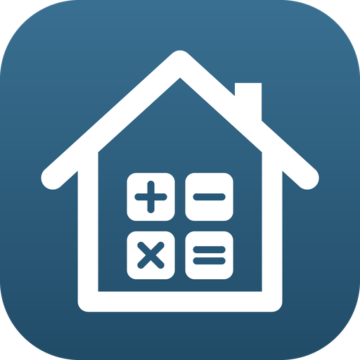
</p>

<h1 align="center">HouseSynk</h1>

<p align="center">
  Calculadora de materiais e custos para obras: do alicerce ao acabamento, com lista de compras e orçamento em PDF.
</p>

<p align="center">
  
  
  
  
</p>

---

## 📱 Sobre

O **HouseSynk** ajuda quem vai construir ou reformar a saber **quanto material comprar e quanto vai gastar**. A pessoa preenche só as partes da obra que quiser, e o app calcula os materiais na unidade em que são vendidos (sacos, latas, barras, rolos, caixas), mostra o custo de cada etapa e monta a lista de compras separada por loja.

O app está sendo preparado para a **App Store**.

---

## 🚀 Funcionalidades

### 🧮 14 calculadoras, organizadas em 3 etapas

| Etapa | Abas |
| --- | --- |
| 🏗️ **Estrutura** | Brocas · Baldrame · Paredes · Laje · Telhado |
| 🔌 **Instalações** | Elétrica · Hidráulica |
| 🎨 **Acabamento** | Contrapiso · Reboco · Piso · Azulejo · Rejunte · Pintura · Esquadrias |

- Nenhuma aba é obrigatória: abas em branco são ignoradas.
- Campos opcionais já vêm com valores padrão (perda, traço, rendimento...).
- Etapas e abas clicáveis no topo, com destaque na etapa e na aba abertas.
- Botões **Anterior**, **Próximo**, **Avançar para a próxima etapa**, **Limpar** (só a aba aberta) e **Finalizar**.
- Ajuda **"?"** em cada aba, explicando os campos.
- Aceita número com vírgula, ponto ou fração (2,5 · 2.5 · 2 1/2).
- Avisos de conferência: se um valor passa do normal (ex.: broca de 300 m), o app pergunta se a pessoa quer continuar, sem travar a conta.
- Resultados na unidade de compra, com perdas já incluídas (concreto, ferro, massa, peças).

### 📊 Resumo da obra

- **Orçamento:** custo de cada etapa, subtotal de materiais e de mão de obra e total da obra.
- **Reserva para imprevistos:** obra tranquila (+10%) ou reforma antiga (+15%), sempre numa linha separada.
- **Lista de compras:** os materiais de todas as abas somados e separados por loja: material básico, acabamento, elétrica, hidráulica e esquadrias (para cotação).
- **WhatsApp:** envia a lista de compras ou um resumo do orçamento com um toque.

### 📄 PDF

- Orçamento, lista de compras ou os dois juntos.
- Cabeçalho com logo, responsável, data e região; tabelas com os materiais e custos.
- Lista de compras com um quadradinho para marcar o que já foi comprado.
- Gráfico **"Onde vai o dinheiro"**: o custo de cada etapa, da mais cara para a mais barata.

### 👤 Conta e histórico

- Login e cadastro, ou uso como visitante.
- Histórico de orçamentos: visualizar, abrir o resumo, editar, renomear, duplicar e excluir.

### 🌎 Idioma e região

- Português e inglês.
- Idioma escolhido separado do país.
- Brasil (R$) e Estados Unidos (US$), com preços por região editáveis.
- Nos Estados Unidos, as medidas são digitadas em ft, in e sq ft (com fração, como 3/8 in), e parte das abas já calcula nas embalagens americanas (thinset, grout, galões de tinta).

---

## 🛠️ Tecnologias

- **Python 3.11**
- **Kivy 2.3.1** e **KivyMD 2.x** (interface)
- **SQLite** (banco local: usuários e orçamentos)
- **ReportLab** (geração do PDF)

---

## 📸 Telas

### 🏠 Entrada

<table>
  <tr>
    <td align="center" valign="top" width="33%">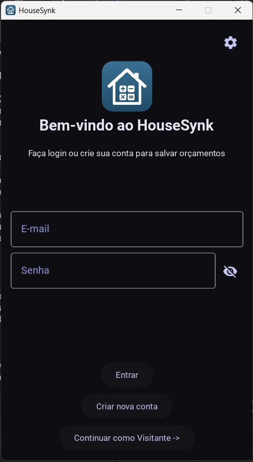<br><sub>Login</sub></td>
    <td align="center" valign="top" width="33%">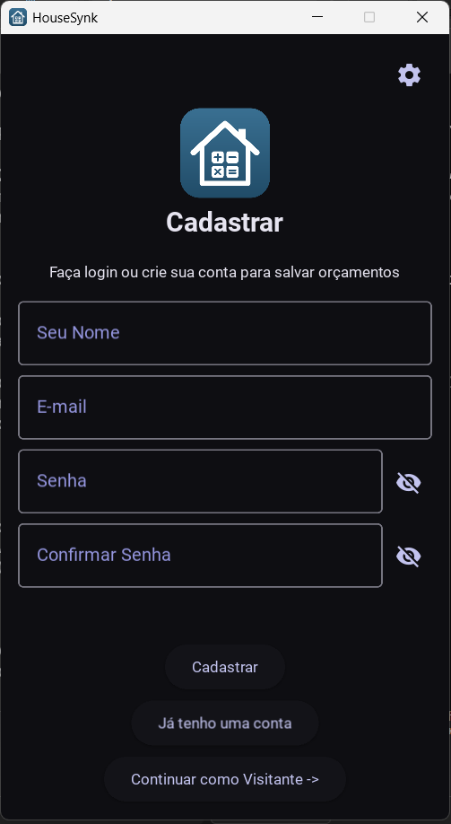<br><sub>Cadastro</sub></td>
    <td align="center" valign="top" width="33%">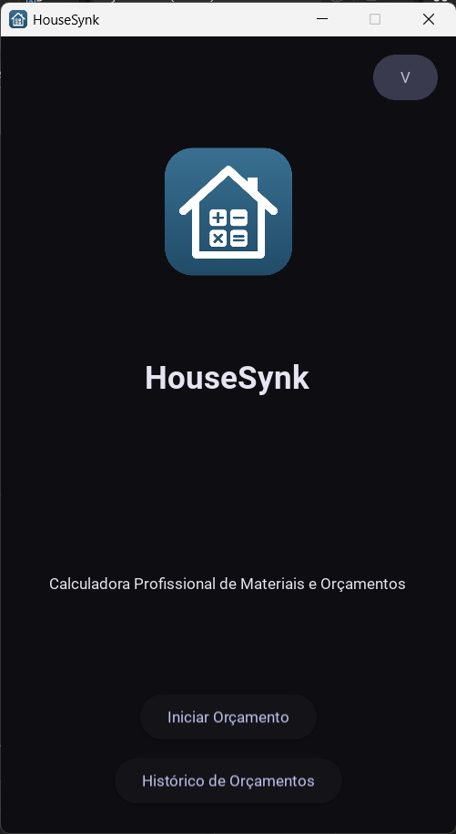<br><sub>Tela inicial</sub></td>
  </tr>
</table>

### 🏗️ Estrutura

<table>
  <tr>
    <td align="center" valign="top" width="33%">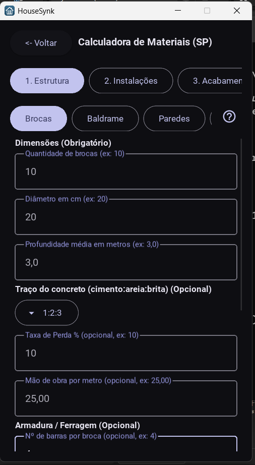<br><sub>Etapas e abas no topo</sub></td>
    <td align="center" valign="top" width="33%">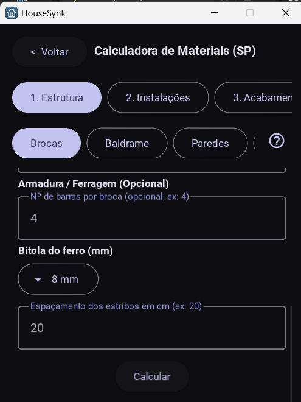<br><sub>Campos opcionais (armadura)</sub></td>
    <td align="center" valign="top" width="33%">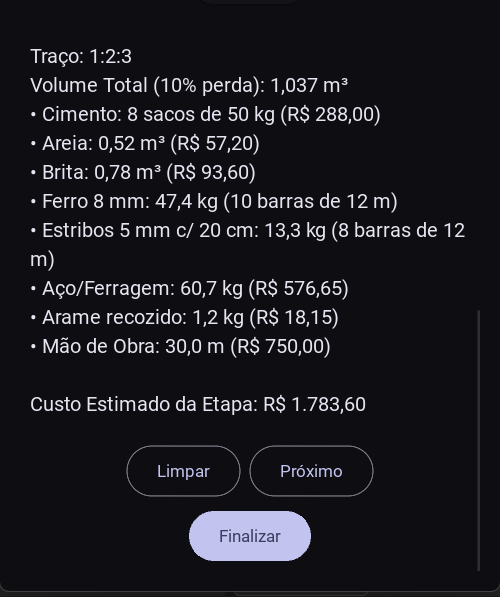<br><sub>Resultado com custo da etapa</sub></td>
  </tr>
</table>

### 🔌 Instalações

<table>
  <tr>
    <td align="center" valign="top" width="33%">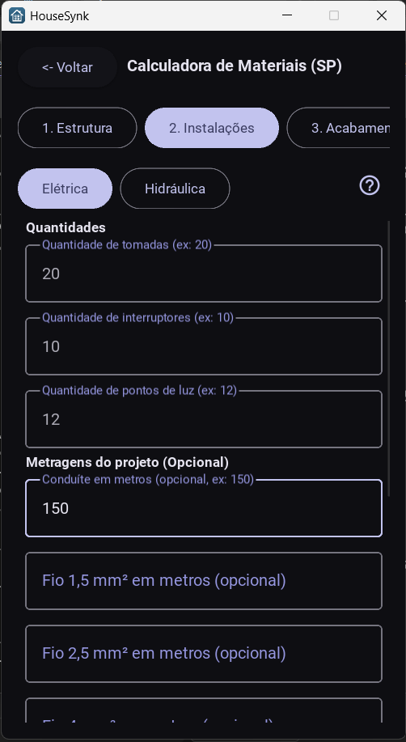<br><sub>Elétrica: quantidades</sub></td>
    <td align="center" valign="top" width="33%">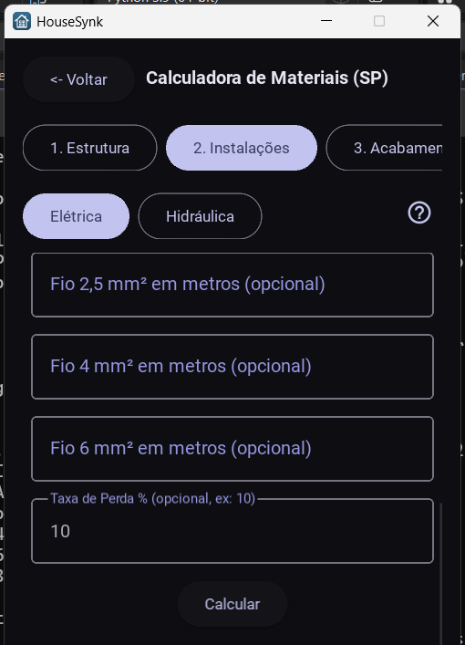<br><sub>Metragens do projeto (opcional)</sub></td>
    <td align="center" valign="top" width="33%">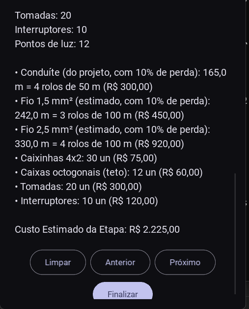<br><sub>Estimado x do projeto</sub></td>
  </tr>
</table>

### 🎨 Acabamento

<table>
  <tr>
    <td align="center" valign="top" width="33%">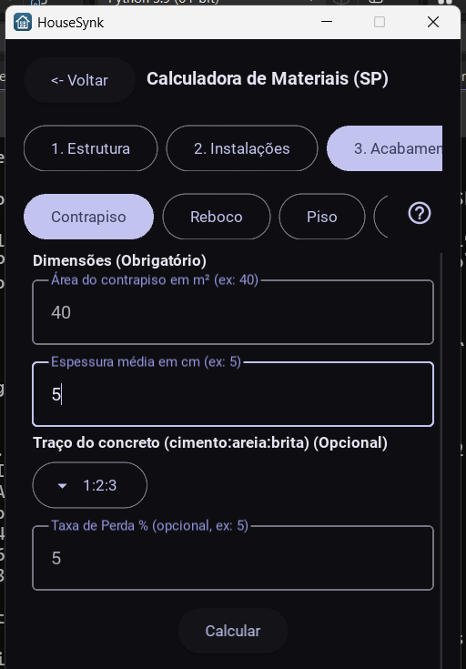<br><sub>Contrapiso</sub></td>
    <td align="center" valign="top" width="33%">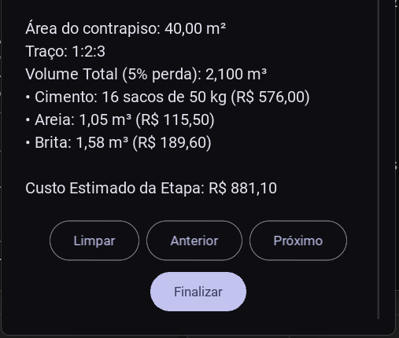<br><sub>Resultado do contrapiso</sub></td>
    <td align="center" valign="top" width="33%">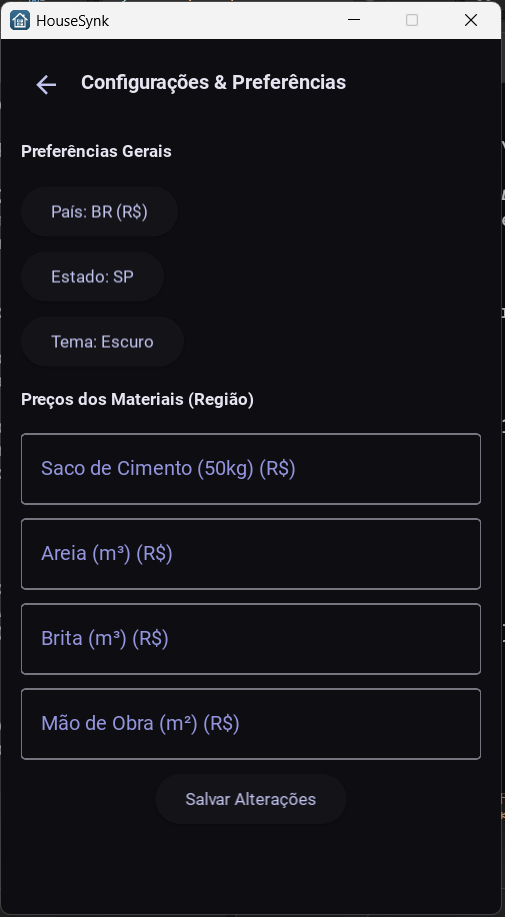<br><sub>Configurações e preços</sub></td>
  </tr>
</table>

### 📊 Resumo

<table>
  <tr>
    <td align="center" valign="top" width="33%">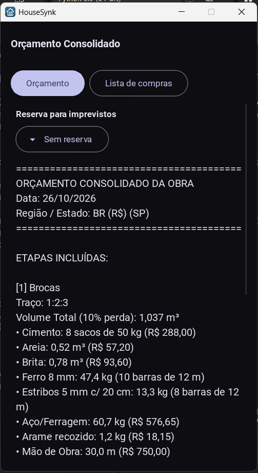<br><sub>Orçamento com reserva para imprevistos</sub></td>
    <td align="center" valign="top" width="33%">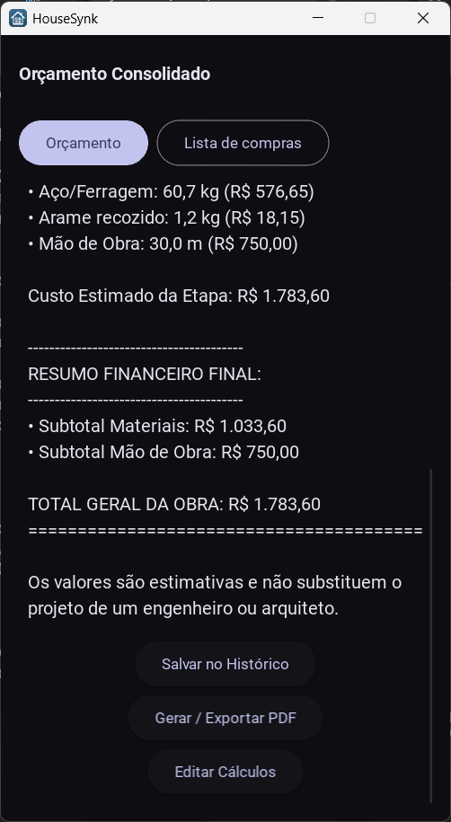<br><sub>Total da obra</sub></td>
    <td align="center" valign="top" width="33%">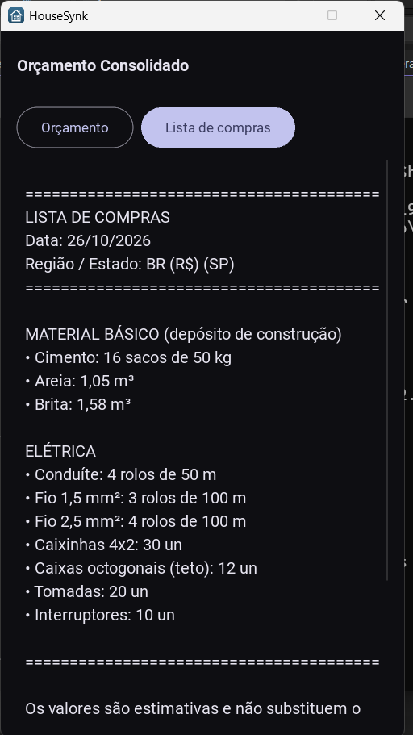<br><sub>Lista de compras por loja</sub></td>
  </tr>
</table>

### 📂 Histórico

<table>
  <tr>
    <td align="center" valign="top" width="33%">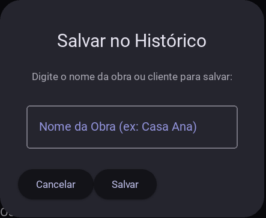<br><sub>Salvar no histórico</sub></td>
    <td align="center" valign="top" width="33%">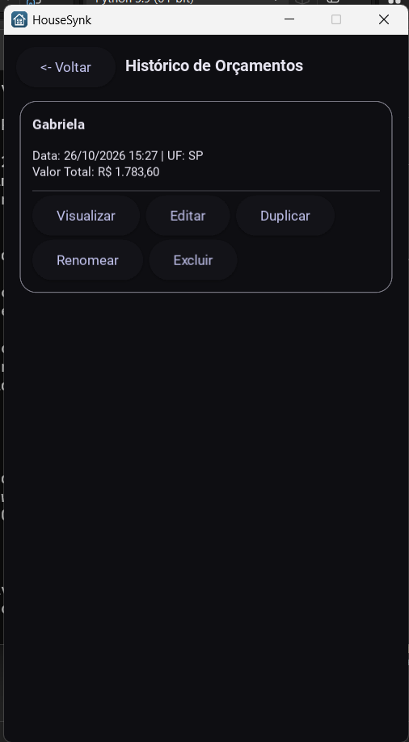<br><sub>Histórico de orçamentos</sub></td>
  </tr>
</table>

### 📄 PDF

<p align="center">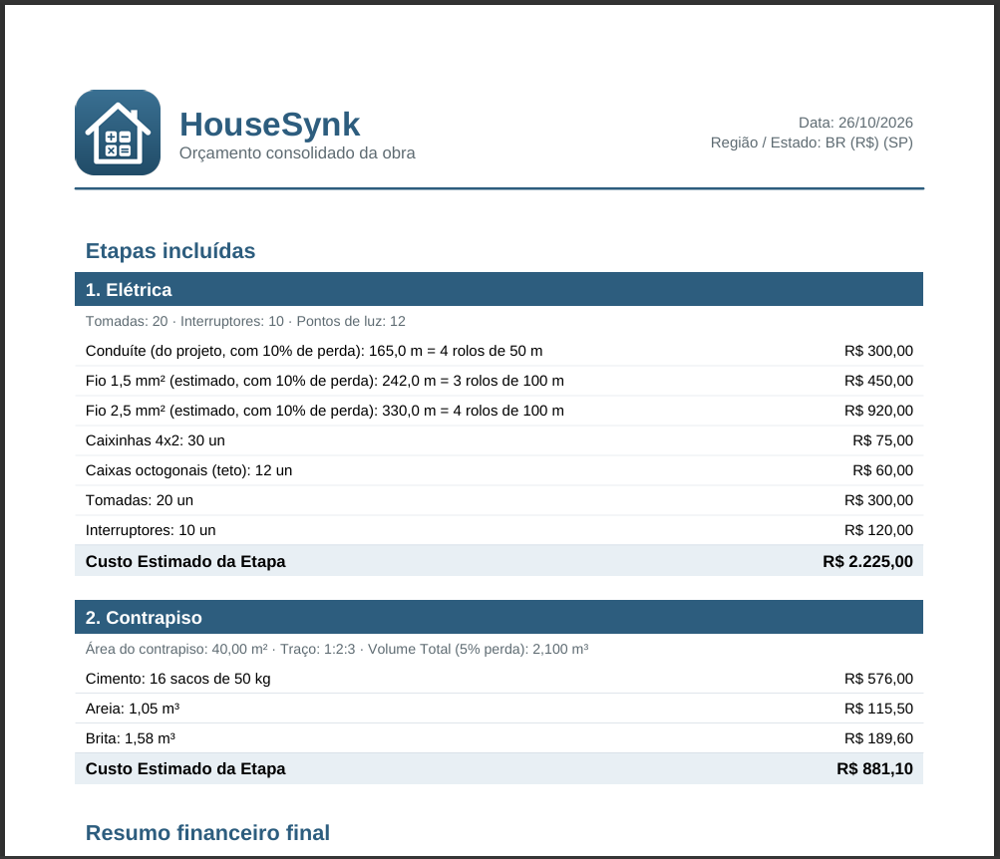</p>

---

## ▶️ Como rodar

```bash
# 1. Baixe o projeto
git clone https://github.com/Gabrielazk/HouseSynk.git
cd HouseSynk/HouseSynk

# 2. (Opcional) crie um ambiente virtual (Python 3.11)
python -m venv .venv
.venv\Scripts\activate        # Windows
# source .venv/bin/activate   # macOS / Linux

# 3. Instale as bibliotecas
python -m pip install -r requirements.txt

# 4. Abra o app
python main.py
```

O PDF é salvo na pasta **Downloads**.

---

## 📁 Estrutura do projeto

```
HouseSynk/
├── main.py                  # inicia o app
├── requirements.txt
├── assets/                  # logo, ícone do app e fonte do PDF
└── src/
    ├── calculators/         # as contas de cada aba (sem nada de tela)
    ├── models/              # banco de dados, cadastro e login
    ├── services/            # lista de compras e geração do PDF
    └── views/               # as telas (uma por arquivo)
```

As contas ficam separadas das telas: a mesma conta pode ser usada no app, no PDF e, no futuro, em outras versões.

---

## 🗺️ Próximos passos

- [x] Compartilhar a lista de compras pelo WhatsApp
- [x] Gráfico de custo por etapa no PDF
- [x] Versão para os Estados Unidos: medidas americanas (ft, in, sq ft) e embalagens de piso, azulejo, rejunte, pintura e impermeabilização
- [ ] Versão para os Estados Unidos: embalagens das outras abas (concreto, ferro, blocos, telhas, fios e tubos)
- [ ] Abas só dos Estados Unidos: estrutura de madeira, OSB e drywall
- [ ] Tabela de preços atualizada por estado (referência SINAPI)
- [ ] Cronograma estimado da obra
- [ ] Publicação na App Store

---

## ⚠️ Aviso

Os valores são **estimativas** e não substituem o projeto de um engenheiro ou arquiteto.

---

## 👩‍💻 Autora

**Gabriela Salviatto**

---

## 📄 Licença

© 2026 Gabriella Salviatto. Todos os direitos reservados. Veja o arquivo [LICENSE](LICENSE).

A fonte usada no PDF (Liberation Sans) é distribuída sob a licença SIL Open Font License; o texto da licença está em `HouseSynk/assets/fonts`.
